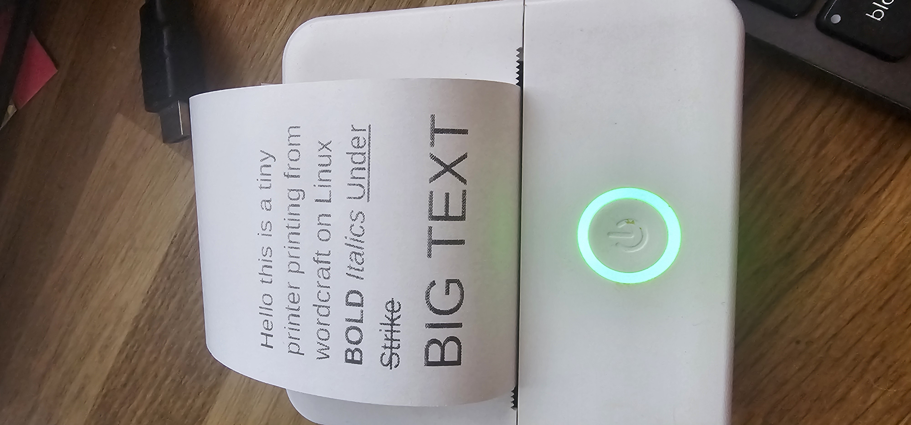
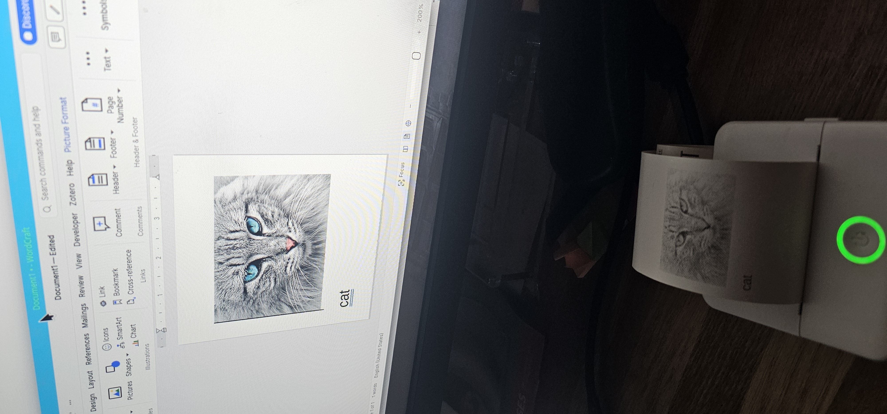

# tinyprinter-linux

Use a **Tiny Print X6h pocket thermal printer as a standard black-and-white
printer on Linux**, without the Android app.

The driver connects over Bluetooth Classic, exposes a CUPS print queue, and
supports PDFs, images, plain text, and applications with ordinary print dialogs.
Physical printing and desktop printing from Wordcraft have been confirmed on
an X6h with a continuous 57 mm paper roll.

This is an independent implementation of the printer's wire protocol,
investigated using REA and JADX against Tiny Print 1.3.87, then checked against
the actual printer. **You do not need REA, JADX, an APK, Android, or an account
to use this driver.** No proprietary application, decompiled application source,
or app artwork is included.

## Printed examples

Actual output from the X6h using this Linux driver and Wordcraft.

### Formatted text

Bold, italic, underlined, strikethrough, and larger text printed on the roll:



### Images

A cat image in Wordcraft alongside its monochrome thermal print:



## What it does

- Bluetooth Classic RFCOMM printing; channel 1 on the tested device.
- A CUPS queue for normal Linux desktop printing.
- 384-dot monochrome raster output at nominal 200 DPI.
- PDF rendering and image-to-black-and-white conversion.
- Command-line text printing through CUPS, including adjustable font sizing.
- Roll lengths of 50, 100, 150, 200, and 300 mm, plus custom 10-5000 mm lengths.
- Print darkness, trailing-blank trimming, and direct-CLI tear-off feed controls.
- CRC checks, buffer-full pause/resume handling, and explicit printer errors.

The roll is 57 mm wide, but the printable width is approximately **48.8 mm**,
centered on the paper. Use about 4.2 mm side margins when preparing documents.

**Compatibility is confirmed for X6h, not for every printer using Tiny Print.**
Bluetooth names, letter case, firmware, and transports can differ even among
similarly named printers. This driver is not ESC/POS, a BLE driver, a USB
driver, or a driverless CUPS 3 implementation.

## Who makes the printer?

**The exact hardware OEM of the tested X6h has not been established.**

The [official Tiny Print Google Play listing](https://play.google.com/store/apps/details?id=com.frogtosea.tinyPrint&hl=en)
names **Shenzhen 100cow Technology Co., LTD.** as the app publisher. That is
evidence about the software publisher, not proof that it manufactured the
printer.

The [krsmoil X5/X6/X7 tutorial](https://krsmoil.com/tiny-print-app-tutorial-for-pocket-label-printer-x5-x6-x7/)
documents products using Tiny Print, but a vendor's X6 listing is not sufficient
to identify the OEM of a specific X6h. Likewise, a chip manufacturer's name
does not identify the printer assembler.

For definitive attribution, check the device/packaging manufacturer label,
regulatory ID, or supplier documentation for the exact hardware revision.
This project is not affiliated with the app publisher or a printer vendor.

## Install the CUPS printer

Tested on Arch/CachyOS with CUPS 2.x and Python 3.14. The Python package requires
Python 3.10 or newer and Pillow; PDF conversion requires Ghostscript.

```sh
git clone https://github.com/rjacobs1969/tinyprinter-linux.git
cd tinyprinter-linux
sudo pacman -S --needed cups cups-filters ghostscript python
```

Turn on the printer and disconnect it from the Android app. Find its address:

```sh
bluetoothctl --timeout 15 scan on
bluetoothctl devices
```

The examples use **`AA:BB:CC:DD:EE:FF` as a placeholder**. Replace it with your
printer's actual Bluetooth MAC address, not its name such as `X6h-1234`.

```sh
sudo sh ./install.sh AA:BB:CC:DD:EE:FF
lpstat -p X6h -v X6h
```

The installer creates `/opt/tinyprint/venv`, installs a CUPS filter and backend,
enables CUPS, and creates an unshared `X6h` queue. It does not alter other queues
or Bluetooth trust settings. It refuses to replace an existing queue.

To choose another queue name:

```sh
sudo sh ./install.sh AA:BB:CC:DD:EE:FF MyLabels
```

On other distributions, install the corresponding packages providing
`python3`, Python venv/pip, `gs`, `lpadmin`, `lpstat`, `cupstestppd`,
`cups-config`, the CUPS PDF/image/text filters, and a running BlueZ service.
The current system installer uses `systemctl`.

## Print PDFs, images, and text

Replace these example filenames with existing files.

```sh
# PDF, on a 57 x 100 mm page
lp -d X6h -o PageSize=Roll100 label.pdf

# Image, fitted to the selected page
lp -d X6h -o PageSize=Roll100 -o fit-to-page picture.png

# A short message: no PDF creation needed
printf 'Hello from Linux!\nSecond line\n' | lp -d X6h -o PageSize=Roll50

# Text file
lp -d X6h -o PageSize=Roll100 notes.txt

# Two copies, custom roll length, darker output
lp -d X6h -n 2 -o PageSize=Custom.57x180mm -o Darkness=Dark label.pdf
```

In Wordcraft or another desktop application, select the `X6h` printer and an
appropriate 57 mm roll page size. A4 documents shrink substantially; preparing
the document at the actual paper size gives much more readable results.

### Adjust text font size

For plain text, CUPS uses **characters per inch (`cpi`)** and **lines per inch
(`lpi`)**. Lower both values to enlarge text while keeping similar proportions.

```sh
# Small
printf 'Small text\n' | lp -d X6h -o PageSize=Roll50 -o cpi=15 -o lpi=9

# Normal
printf 'Normal text\n' | lp -d X6h -o PageSize=Roll50 -o cpi=10 -o lpi=6

# Large
printf 'Large text\n' | lp -d X6h -o PageSize=Roll50 -o cpi=8 -o lpi=4.8
```

To control wrapping and margins:

```sh
printf 'Item: coffee\nPrice: 2.50\nThank you!\n' | \
  lp -d X6h -o PageSize=Roll50 -o cpi=10 -o lpi=6 \
    -o wrap=true -o columns=1 -o prettyprint=false \
    -o page-left=12 -o page-right=12 -o page-top=6 -o page-bottom=6
```

Margins are in points: 12 points is about 4.2 mm. `cpi`/`lpi` only affect
plain-text conversion; they do not change fonts inside PDFs or images.
For exact point sizes, font families, or mixed bold/normal text, prepare a PDF.
[USAGE.txt](USAGE.txt) includes a copyable Ghostscript example with a 16-point
heading and a 10-point second line.

### Driver options

| Option | Values | Default |
| --- | --- | --- |
| `PageSize` | `Roll50`, `Roll100`, `Roll150`, `Roll200`, `Roll300`, `Custom.57xHEIGHTmm` | `Roll100` |
| `Resolution` | `200dpi` | `200dpi` |
| `Darkness` | `Light`, `Normal`, `Dark` | `Normal` |
| `Trim` | `True`, `False` | `True` |

`Trim=True` removes trailing white rows, not top margins. Each page still adds
96 dots (about 12.2 mm) of tear-off feed. Use `Trim=False` to retain the full
selected page length.

```sh
lpoptions -p X6h -l
lpoptions -p X6h -o PageSize=Roll50 -o Darkness=Normal
lpstat -o X6h
cancel X6h-123
```

See [USAGE.txt](USAGE.txt) for the complete option reference, saved defaults,
font/layout controls, job management, and troubleshooting.

## Direct Bluetooth CLI, without CUPS

```sh
python3 -m venv .venv
.venv/bin/python -m pip install .

# Query information/status without printing
.venv/bin/tinyprint info --address AA:BB:CC:DD:EE:FF

# Print an image at the full 384-dot printable width
.venv/bin/tinyprint print --address AA:BB:CC:DD:EE:FF picture.png

# Print a PDF with explicit length, energy, and tear-off feed
.venv/bin/tinyprint print --address AA:BB:CC:DD:EE:FF label.pdf \
  --height-mm 100 --energy 5000 --feed 96

# Render to a new protocol-data file without connecting
.venv/bin/tinyprint encode label.pdf label.bin --height-mm 100
```

`--height-mm` applies to PDFs only. Direct images scale to the full printable
width while retaining their aspect ratio. `--keep-blank` retains trailing blank
rows; `--feed` accepts 0-1000 dots; `--energy` accepts 1-8000.
`encode` refuses to overwrite its output. The CLI accepts PDFs and images,
not plain text; use CUPS for text. Run `tinyprint print --help` for details.

After system installation the same CLI is available at
`/opt/tinyprint/venv/bin/tinyprint`.

## Adapt to another printer ID

### Another X6h: change the Bluetooth address

You **do not need to edit the source** for another compatible X6h. Discover
its MAC address, query it using `tinyprint info --address YOUR_MAC`, then pass
that address to the installer. Its Bluetooth display name is not an argument.

For an existing queue, update only its device URI:

```sh
sudo lpadmin -p X6h -v 'tinyprint:///AA:BB:CC:DD:EE:FF?channel=1'
```

The URI requires **three slashes**: the MAC belongs in the path, not the
hostname. Putting colon-separated addresses after `tinyprint://` makes CUPS
interpret part of the address as an invalid port.

If service discovery or vendor documentation establishes a different RFCOMM
channel, use `--channel N` for the direct CLI and `?channel=N` in the queue URI.
Changing a channel does not make an incompatible protocol compatible.

### A different model: verify the protocol first

The current implementation has **no selectable model profiles**. A different
Bluetooth name or another model supported by Tiny Print is not evidence that
this driver is safe or compatible. `X6h` and `X6H` are distinct app identifiers.
A [community X6h investigation](https://parzivail.github.io/ble-thermal-printer/)
used BLE; our tested unit works over Bluetooth Classic. Check your exact unit.

Before attempting to port the driver:

1. Establish transport: Bluetooth Classic SPP/RFCOMM versus BLE/GATT.
2. Determine printhead width, DPI, paper width, and safe energy/speed values
   from the exact model's configuration or hardware documentation.
3. Verify command framing, CRC, raw-raster support, bit order, flow control,
   status flags, and any required prefix or initialization sequence.
4. Query information/status before printing. Only then try a small raster
   using verified conservative settings.

Relevant files:

| File | What a genuinely different model may require |
| --- | --- |
| `tinyprint/protocol.py` | `WIDTH`, `DPI`, derived row length, command framing, CRC, print sequence, validated energy/feed limits |
| `tinyprint/transport.py` | A new BLE transport if necessary; RFCOMM channel, write sizing/timing, status and flow-control behavior |
| `tinyprint/render.py` | Paper width and rasterization geometry; `PAPER_MM` |
| `tinyprint/cups.py` | Paper-size parsing, margins/geometry assumptions, supported-command validation, darkness mapping |
| `cups/X6h.ppd` | Model name, resolution, paper dimensions, printable margins, custom-size limits |
| `install.sh` | Queue/PPD selection and connection settings |
| `tests/test_tinyprint.py` | Captured protocol fixtures, bit ordering, model settings, native CUPS URI checks |

Keep renderer geometry, row lengths, PPD dimensions, and backend validation
consistent. Changing only `WIDTH` or the PPD is not a complete port. Do not
raise thermal-energy limits by guesswork, send firmware-update commands, or
rewrite a device's identity to make it appear compatible.

For your own supplied app artifact, the model configuration and methods
identified in [PROTOCOL.txt](PROTOCOL.txt) are useful investigation entry
points. Differences must be established from that model's evidence, not from
filenames or a seller's product title.

## Errors and development

Paper-out, open cover, overheating, low battery, disconnects, corrupt replies,
and timeouts are errors. CUPS stops rather than automatically retrying a job
that may have partially printed. Resolve the cause, cancel duplicates if
necessary, and use `cupsenable X6h` to resume.

The CUPS 2.x driver-deprecation warning is expected; a `Bad device-uri` error
is not. See the installation and URI instructions above.

Run the focused tests:

```sh
.venv/bin/python -m unittest discover -s tests -v
sh -n install.sh cups/tinyprint-backend cups/tinyprint-filter
```

[PROTOCOL.txt](PROTOCOL.txt) records the APK digest, REA evidence identifiers,
observed wire format, corroborating hardware observations, and limitations.
APKs, private analysis output, virtual environments, and generated build
files are intentionally excluded from this repository.
